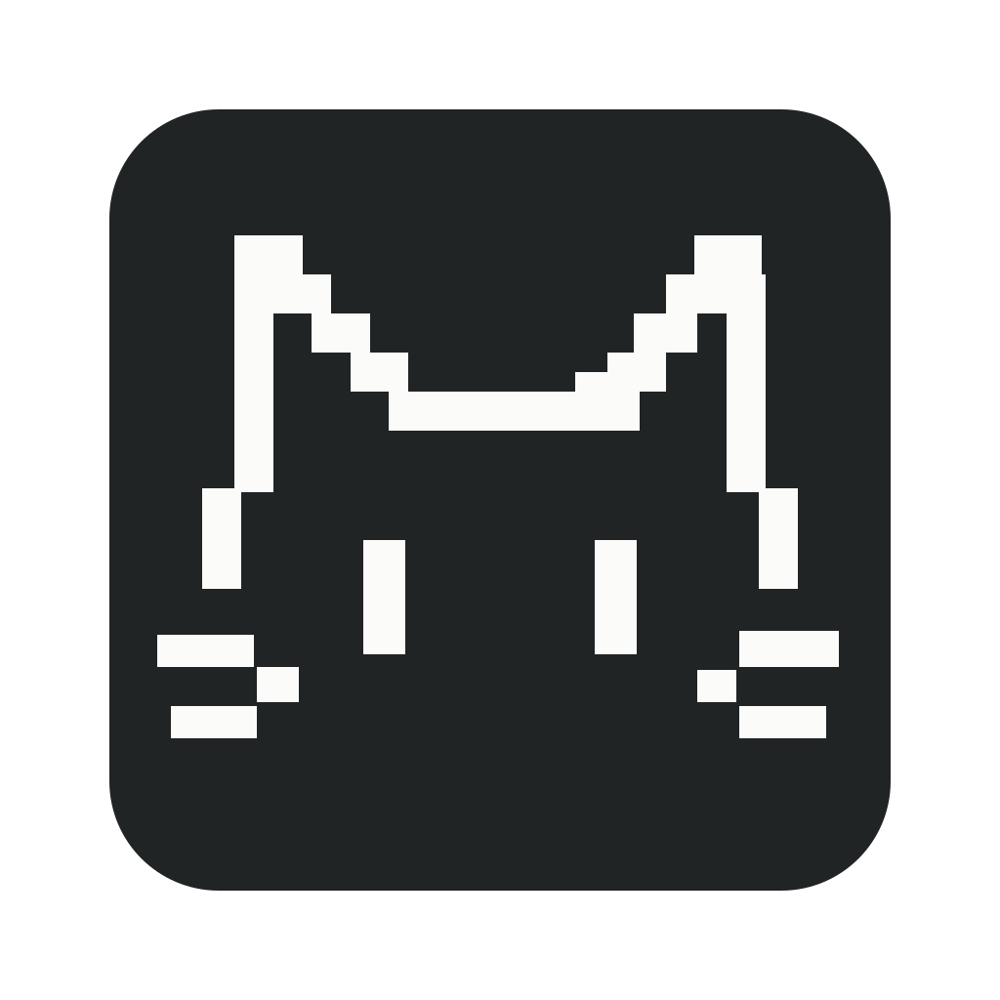
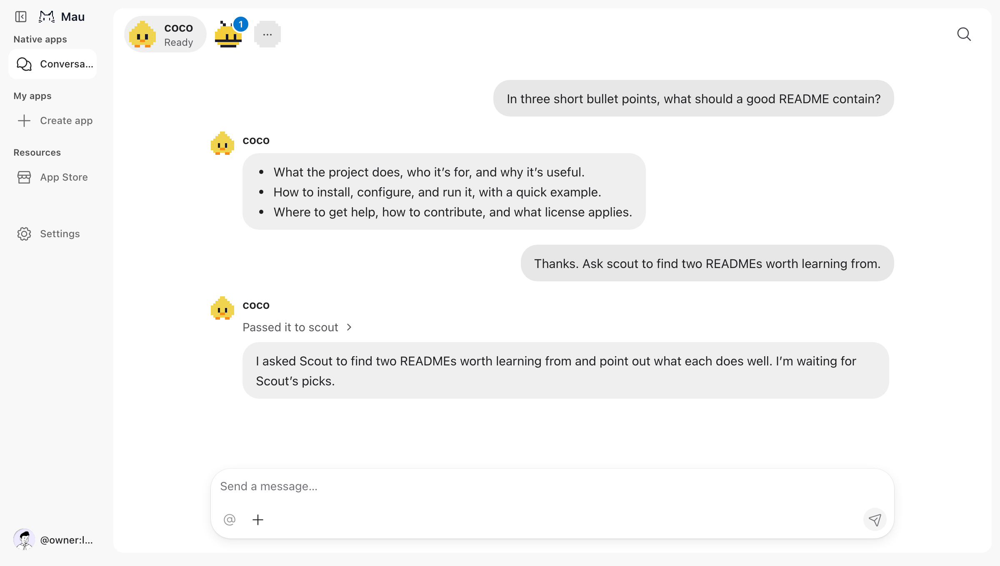

<div align="center">



# Mau

**Your own team of AI partners, running in your own cloud.**

Each partner is a native coding agent with its own sandbox, memory and chat.
Talk to them from the web, the command line or your chat apps; they can recruit and message each other.

[](https://github.com/Olorinm/mau/actions/workflows/ci.yml)
[](https://github.com/Olorinm/mau/releases)
[](LICENSE)
[](https://nodejs.org)

[Try it locally](#-try-it-in-two-minutes) · [Deploy your own](#-deploy-your-own) · [CLI](#-drive-it-from-the-command-line) · [Docs](#-documentation)



</div>

## What you get

- 🧑‍🤝‍🧑 **Partners, not one chatbot.** Each has a name, a duty, its own memory and conversation. A partner can recruit
  another, hand work over and wait for the answer.
- 📦 **A real sandbox per partner.** A native agent (Codex by default) works in its own container with
  files and a shell. Idle sandboxes pause; a message wakes them.
- 💬 **Reach them anywhere.** Web console, CLI, Feishu, Weixin, Telegram, email and push, all in one conversation
  history.
- 🔐 **You stay in control.** Writes to your accounts wait for your approval on a card. Credentials live outside the
  sandbox. Everything runs in your own Cloudflare account.
- 🤖 **Built to be operated by agents.** One command to run locally, one to deploy, one to diagnose. Every action is
  a CLI command that prints JSON, and every HTTP route is listed by `mau api`.

## 🚀 Try it in two minutes

You need Node.js 24+, a running Docker engine and a Codex sign-in (`codex login`). No cloud account.

```sh
git clone https://github.com/Olorinm/mau && cd mau
node scripts/bootstrap.mjs && npm run build && npm run build:web
node dist/cli.js local                                    # runs until you stop it; prints the console address
```

In another terminal:

```sh
node dist/cli.js partner create helper --profile codex    # about two minutes the first time
node dist/cli.js chat send helper "hello"
```

```jsonc
{
  "state": "completed",
  "replies": [{ "role": "assistant", "sender": "helper", "text": "Hello! What would you like to work on?" }],
  "pendingCards": []
  // trimmed: ids and timestamps
}
```

Local mode is for trying Mau out: its only login is a token in a private file and its sandboxes have unrestricted
network access. More in [docs/local.md](docs/local.md).

## ☁️ Deploy your own

Mau runs in your Cloudflare account as one Worker with one container. From the same checkout:

```sh
node dist/cli.js deploy --hostname mau.example.com --owner-email you@example.com
```

The command creates the buckets, the sandbox gateway, the login (Cloudflare Access) and the configuration, then
deploys. Every step first checks what already exists, so running it again continues after a failure and upgrades a
deployment later. When your credentials cannot do a step, it tells you exactly what to do by hand and how to
continue.

```sh
node dist/cli.js doctor        # what is missing or broken, with the fix for each finding
```

Prerequisites, the API token permissions and what a human still does: [docs/deployment.md](docs/deployment.md).

## ⌨️ Drive it from the command line

Install the client on any machine (it has no server dependencies), then sign in to your deployment:

```sh
npm install --global https://github.com/Olorinm/mau/releases/download/v0.1.0-alpha.55/olorinm-mau-cli-0.1.0-alpha.55.tgz
mau login https://mau.example.com
```

Commands read as `mau NOUN VERB NAME`, and a partner is always named:

| Command | What it does |
| --- | --- |
| `mau partner create scout --share helper --duty "Finds sources"` | A second partner in helper's sandbox |
| `mau chat send helper "Summarise yesterday's notes"` | Send, wait for the turn, print the replies |
| `mau card list` · `mau card answer helper CARD_ID Approve` | See and answer approvals and questions |
| `mau memory show helper` | What the partner remembers |
| `mau channel connect helper feishu` | Reach the partner from a chat app |
| `mau env pause helper` · `mau env resume helper` | Control its sandbox |
| `mau api` | Every HTTP route; `mau api METHOD PATH` calls one |

Output is one JSON document on stdout. A failure is one JSON object on the last stderr line with exit code 1.
Nothing is asked interactively, so an agent can drive it as well as a person. Every command:
[docs/cli.md](docs/cli.md) or `mau --help`.

## 🧩 How it works

Mau is a thin product layer over [Agent Kit](https://github.com/Olorinm/agent-kit). It contains no model loop.

```text
you ── web · CLI · chat apps ──▶ Router ──▶ Host ──▶ native agent (Codex, Claude)
                                   │           └── runs inside a sandbox from Environment
                                   └── Connectors: your Google, GitHub, Notion, Feishu, browser
```

| Part | Does |
| --- | --- |
| [Router](https://github.com/Olorinm/agent-kit/tree/main/packages/router) | Accounts, channels, the conversation history, delivery |
| [Host](https://github.com/Olorinm/agent-kit/tree/main/packages/host) | Runs the native agent; keeps its sessions, tools and approvals |
| [Environment](https://github.com/Olorinm/agent-kit/tree/main/packages/environment) | Creates, pauses and resumes sandboxes (Cloudflare, or Docker locally) |
| [Connectors](https://github.com/Olorinm/agent-kit/tree/main/packages/connectors) | Access to your services, with credentials and approvals outside the sandbox |
| **Mau** | Partners, memory, schedules, the web console, the CLI, deployment |

## 📚 Documentation

| | |
| --- | --- |
| [Local mode](docs/local.md) | Run everything on one machine |
| [Deployment](docs/deployment.md) | Deploy, upgrade, diagnose; how state and backups work |
| [CLI](docs/cli.md) | Every command and the output contract |
| [Web console](docs/web.md) · [中文](docs/web.zh-CN.md) | Sign-in and what the console covers |
| [Environments](docs/environments.md) · [中文](docs/environments.zh-CN.md) | Profiles, several kernels, shared sandboxes, SSH |
| [Partners, memory and schedules](docs/native-work.md) | How partners work together and what they remember |
| [Connector accounts](docs/connector-accounts.md) | Connecting your services and per-operation permissions |

## 🛠 Development

```sh
node scripts/bootstrap.mjs   # downloads the pinned Agent Kit release and installs dependencies
npm run build && npm test
```

`components.json` pins one Agent Kit release with the integrity of each archive; `node scripts/pin-kit.mjs VERSION`
moves to another. The web console and its components are in [`web/`](web) and [`web/ui`](web/ui/README.md). The
server needs Node.js 24.22.2 or newer.

## License

[MIT](LICENSE). Third-party notices: [NOTICE](NOTICE).
