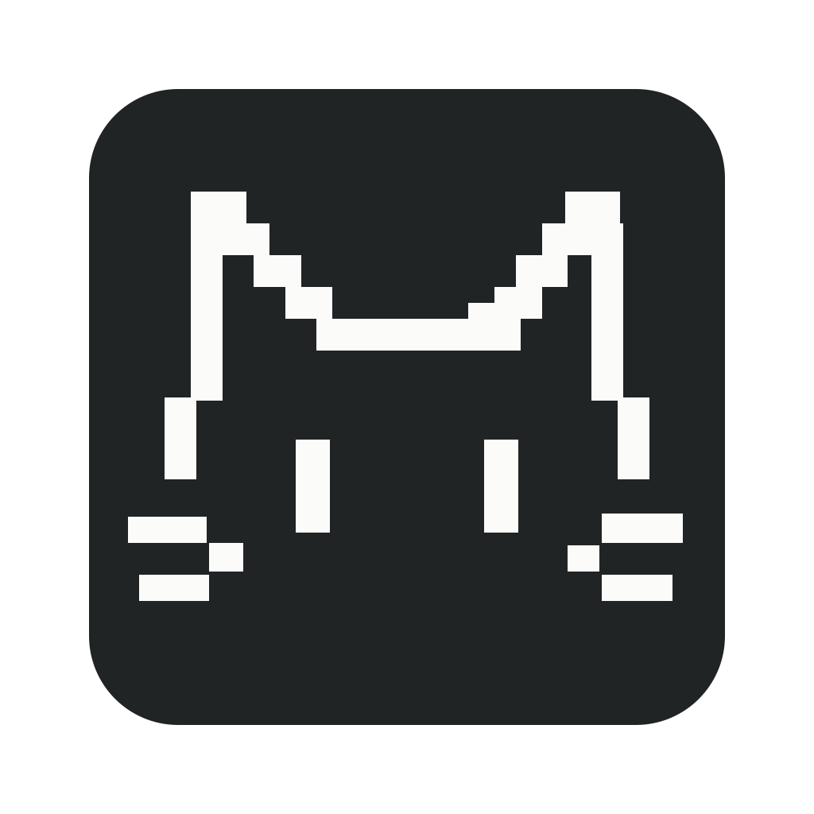
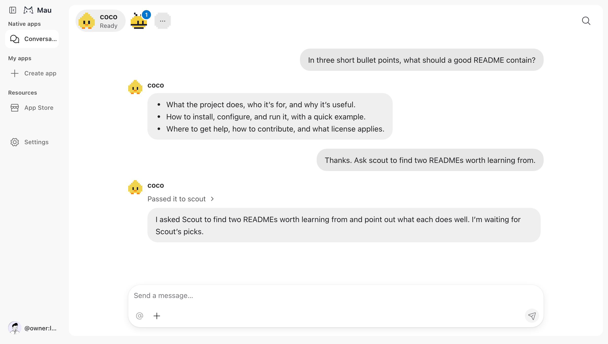

<div align="center">

<picture>
  <source media="(prefers-color-scheme: dark)" srcset="docs/images/mau-dark.svg">
  
</picture>

# Mau

[English](README.md) | **简体中文**

**你自己的 AI 伙伴团队，跑在你自己的云上。**

每个伙伴都是一个原生编程 Agent，有自己的沙箱、记忆和对话。
你可以在网页、命令行或聊天软件里找它们；它们之间也能互相招募、互相发消息。

[](https://github.com/Olorinm/mau/actions/workflows/ci.yml)
[](https://github.com/Olorinm/mau/releases)
[](LICENSE)
[](https://nodejs.org)

[本机试用](#-两分钟本机试用) · [部署自己的](#-部署自己的) · [命令行](#-用命令行操作) · [文档](#-文档)



</div>

## 你能得到什么

- 🧑‍🤝‍🧑 **是一群伙伴，不是一个聊天机器人。** 每个伙伴有名字、职责、自己的记忆和对话。一个伙伴可以招募另一个，
  把工作交给它，再等它的答复。
- 📦 **每个伙伴一个真实的沙箱。** 原生 Agent（默认是 Codex）在自己的容器里工作，有文件、有终端。
  沙箱空闲时自动暂停，来消息就唤醒。
- 💬 **在哪里都能找到它们。** 网页控制台、命令行、飞书、微信、Telegram、邮件和推送，共用同一份对话记录。
- 🔐 **控制权在你手里。** 对你账号的写操作要等你在卡片上批准。凭证放在沙箱之外。所有东西都跑在你自己的
  Cloudflare 账号里。
- 🤖 **为被 Agent 操作而设计。** 一条命令本机运行，一条命令部署，一条命令体检。每个操作都是一条输出 JSON
  的命令，`mau api` 列出全部 HTTP 接口。

## 🚀 两分钟本机试用

需要 Node.js 24+、一个在运行的 Docker，以及 Codex 登录（`codex login`）。不需要任何云账号。

```sh
git clone https://github.com/Olorinm/mau && cd mau
node scripts/bootstrap.mjs && npm run build && npm run build:web
node dist/cli.js local                                    # 一直运行到你停止它；会打印控制台地址
```

在另一个终端里：

```sh
node dist/cli.js partner create helper --profile codex    # 第一次大约两分钟
node dist/cli.js chat send helper "hello"
```

```jsonc
{
  "state": "completed",
  "replies": [{ "role": "assistant", "sender": "helper", "text": "Hello! What would you like to work on?" }],
  "pendingCards": []
  // 省略了 id 和时间戳
}
```

本地模式只用于试用：它唯一的登录方式是一个私有文件里的令牌，沙箱的网络访问也不受限制。
详见 [docs/local.md](docs/local.md)（英文）。

## 🌐 部署自己的

Mau 跑在你的 Cloudflare 账号里：一个 Worker 加一个容器。在同一份代码里执行：

```sh
node dist/cli.js deploy --hostname mau.example.com --owner-email you@example.com
```

这条命令会创建存储桶、沙箱网关、登录保护（Cloudflare Access）和全部配置，然后部署。每一步都先检查已经存在
什么，所以失败后重跑同一条命令就能接着做，以后升级也是这条命令。遇到你的凭证做不了的步骤，它会明确告诉你
需要手动做什么、做完怎么继续。

```sh
node dist/cli.js doctor        # 缺什么、坏了什么，每一项都给出修复办法
```

前置条件、API 令牌需要的权限、哪些步骤仍然要人来做：见 [docs/deployment.md](docs/deployment.md)（英文）。

## 💻 用命令行操作

在任意一台机器上安装客户端（它不带任何服务端依赖），然后登录你的部署：

```sh
npm install --global https://github.com/Olorinm/mau/releases/download/v0.1.0-alpha.57/olorinm-mau-cli-0.1.0-alpha.57.tgz
mau login https://mau.example.com
```

命令的形式是 `mau 对象 动作 名字`，伙伴一律用名字指定：

| 命令 | 作用 |
| --- | --- |
| `mau partner create scout --share helper --duty "Finds sources"` | 在 helper 的沙箱里再建一个伙伴 |
| `mau chat send helper "Summarise yesterday's notes"` | 发消息，等这一轮结束，打印回复 |
| `mau card list` · `mau card answer helper CARD_ID Approve` | 查看并回答审批和提问 |
| `mau memory show helper` | 这个伙伴记住了什么 |
| `mau channel connect helper feishu` | 从聊天软件里找到这个伙伴 |
| `mau env pause helper` · `mau env resume helper` | 控制它的沙箱 |
| `mau token create my-agent --scope chat --scope approve` | 给替你操作 Mau 的 Agent 发一把有范围、有期限、可作废的令牌 |
| `mau api` | 全部 HTTP 接口；`mau api METHOD PATH` 调用其中一个 |

输出是标准输出上的一份 JSON。失败时，标准错误的最后一行是一个 JSON 对象，退出码为 1。命令不会停下来
提问，所以人能用，Agent 也能用。全部命令见 [docs/cli.md](docs/cli.md)（英文）或 `mau --help`。

## 🧩 工作原理

Mau 是 [Agent Kit](https://github.com/Olorinm/agent-kit/blob/main/README.zh-CN.md) 之上很薄的一层产品，自己不包含模型循环。

```text
你 ── 网页 · 命令行 · 聊天软件 ──▶ Router ──▶ Host ──▶ 原生 Agent（Codex、Claude）
                                     │           └── 运行在 Environment 提供的沙箱里
                                     └── Connectors：你的 Google、GitHub、Notion、飞书、浏览器
```

| 组成 | 负责 |
| --- | --- |
| [Router](https://github.com/Olorinm/agent-kit/tree/main/packages/router) | 账号、渠道、对话记录、消息投递 |
| [Host](https://github.com/Olorinm/agent-kit/tree/main/packages/host) | 运行原生 Agent，保留它的会话、工具和审批 |
| [Environment](https://github.com/Olorinm/agent-kit/tree/main/packages/environment) | 创建、暂停、恢复沙箱（云上用 Cloudflare，本机用 Docker） |
| [Connectors](https://github.com/Olorinm/agent-kit/tree/main/packages/connectors) | 访问你的各种服务，凭证和审批都在沙箱之外 |
| **Mau** | 伙伴、记忆、定时任务、网页控制台、命令行、部署 |

## 📚 文档

| | |
| --- | --- |
| [本地模式](docs/local.md)（英文） | 在一台机器上跑起全部 |
| [部署](docs/deployment.md)（英文） | 部署、升级、体检；数据和备份怎么工作 |
| [命令行](docs/cli.md)（英文） | 每条命令和输出约定 |
| [网页控制台](docs/web.zh-CN.md) · [English](docs/web.md) | 登录方式和控制台的功能 |
| [环境](docs/environments.zh-CN.md) · [English](docs/environments.md) | 环境方案、多个内核、共用沙箱、SSH |
| [伙伴、记忆和定时任务](docs/native-work.md)（英文） | 伙伴怎么协作、记住什么 |
| [连接器账号](docs/connector-accounts.md)（英文） | 接入你的服务，以及逐项操作的权限 |

## 🛠 开发

```sh
node scripts/bootstrap.mjs   # 下载锁定的 Agent Kit 版本并安装依赖
npm run build && npm test
```

`components.json` 锁定一个 Agent Kit 版本以及每个包的校验值；用 `node scripts/pin-kit.mjs VERSION` 换到另一个
版本。网页控制台和它的组件在 [`web/`](web) 和 [`web/ui`](web/ui/README.md)。服务端需要 Node.js 24.22.2 或更新。

## 许可

[MIT](LICENSE)。第三方声明见 [NOTICE](NOTICE)。
